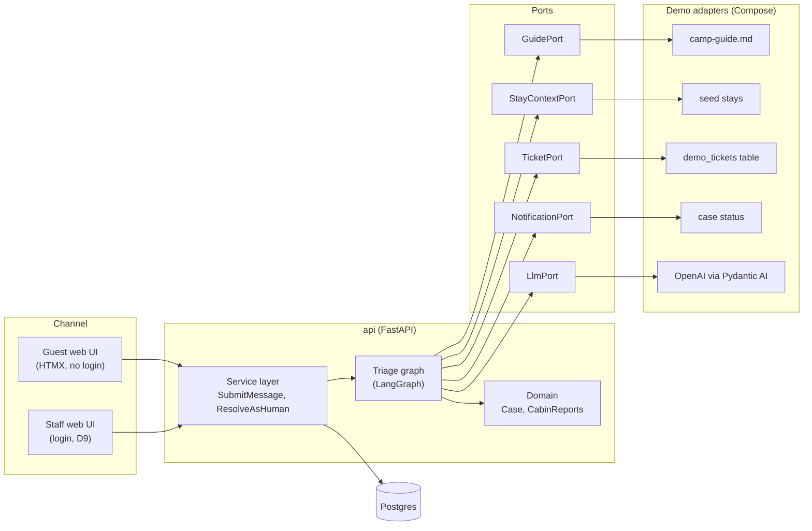
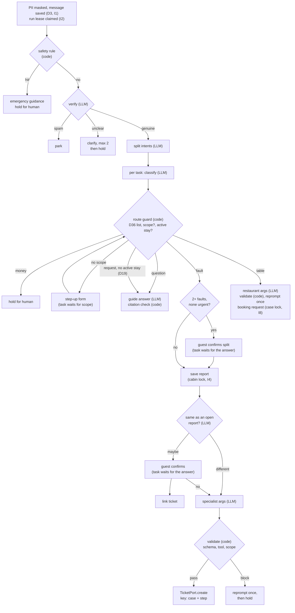
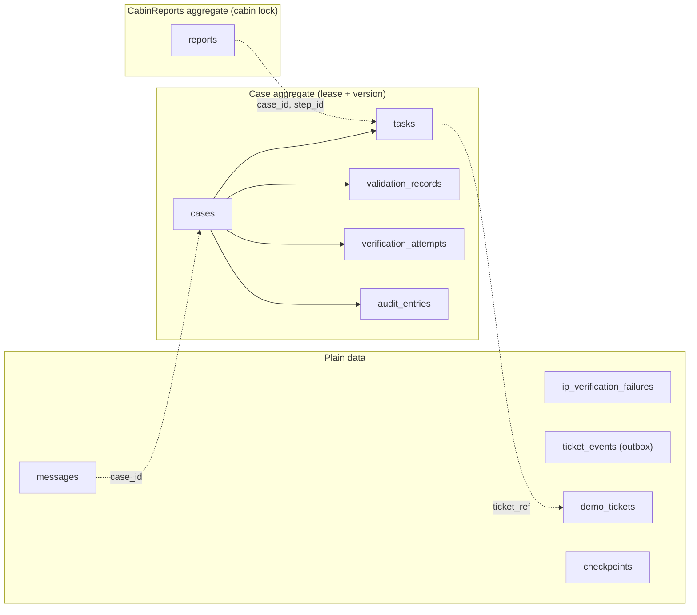
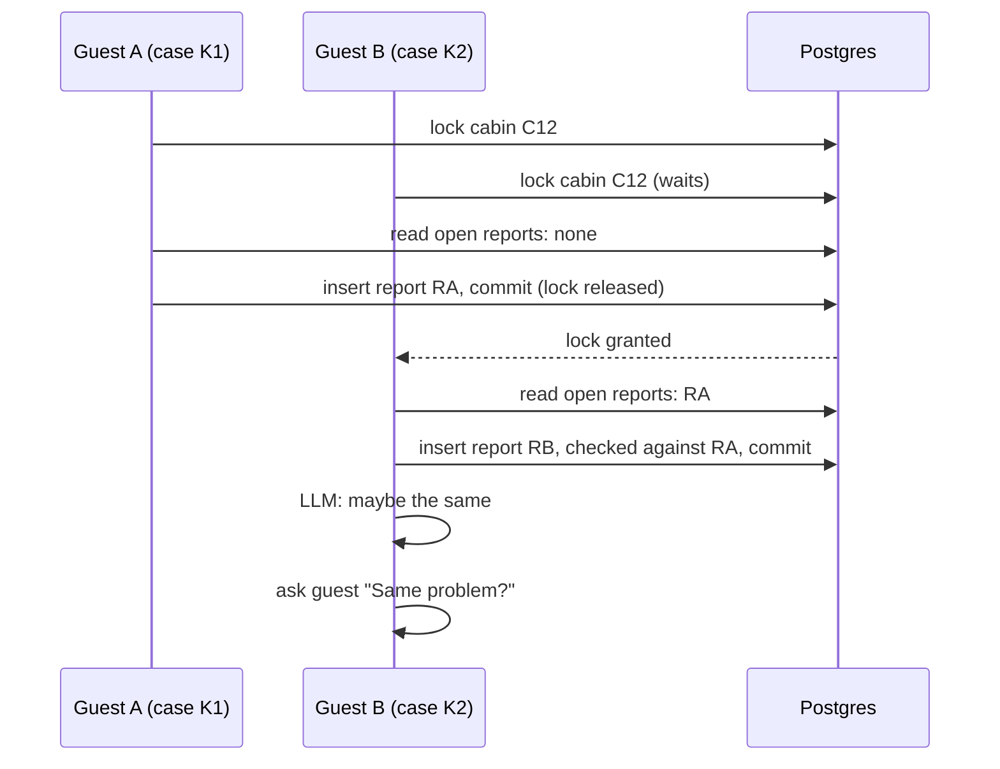
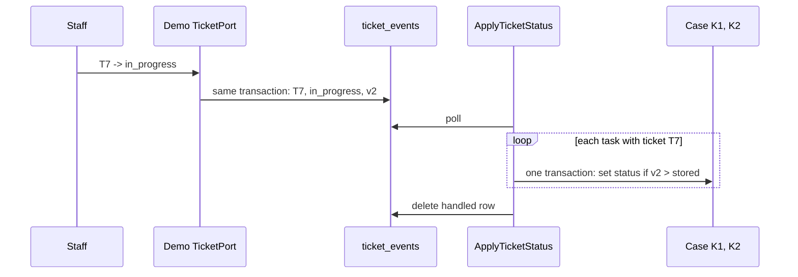

# Architecture

Diagrams for [`plan.md`](plan.md). Rules and names come from [`domain.md`](domain.md).

## Ports and adapters

The graph depends only on ports. Compose wires the demo adapters; a camp wires its own.

## Triage graph

Code decides and the LLM proposes (D24). Every step commits one aggregate. A Case step writes one
audit entry; the report step's record is the report row (plan-deviations D11).

## Data

Two aggregates. Everything else is plain data.

## The hard part: two reports at once (I4)

## Ticket status back to the case (I12)

