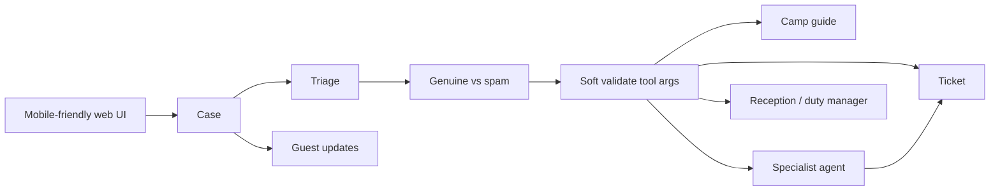

# Camp Guest AI Agent - Brief

## Use case

A guest arrives at a holiday camp, reaches their cabin or pitch, and is introduced to **Camp Guest AI Agent**: a 24x7 on-site assistant.

The guest can ask for information, make a request, or raise a complaint. The agent must:

1. **Understand** what they need and how urgent it is.
2. **Triage** - resolve from a camp guide when it can, or hand off when it cannot.
3. **Act** - create a ticket and/or call a specialist agent (maintenance, cleaning, restaurant).
4. **Keep the guest updated** until the request is done or clearly handed to a human.

Urgent work (leak, no hot water, safety) must jump the queue. Routine work (extra towels, dinner booking) can wait. The agent must not invent camp facts; it uses a guide and tools. It must not pretend a job is finished when it only opened a ticket.

**Intake is open.** Guests submit without login or authentication. Soft context is welcome (cabin/pitch number, name on the booking) but not a gate. Because the door is open, triage must be smart enough to tell a **genuine guest request** from **spam, abuse, or nonsense** before it creates tickets or calls specialists.

**Channels (scope).** v1 ships a **mobile-friendly web interface** only (phone-first in the browser on site or at home). WhatsApp and other messaging channels are planned later behind the same `SubmitMessage` command - not built in v1.

**LLM output is not trusted.** Model replies are never treated as 100% safe or correct. Before the graph goes further - especially before any tool call - a **soft validation** step checks that structured args are legitimate: known tool, allowed fields, cabin/pitch that belongs to **this** case. A model must not step into another guest's cabin, booking, or ticket. Invalid or cross-cabin args are blocked, clarified, or sent to a human - never executed.

This repo is independent. Someone who clones it, runs Docker Compose, and sets an AI API key should be able to play guest and staff flows end to end against a **demo integration** (seeded camp data, in-process tickets). The same ports that back that demo are what a camp team would implement against their real booking, ticketing, or F&B systems - without rewriting triage or specialists.

### Domain (high level)



| Concept | Meaning |
|---|---|
| Channel | How the message arrives. v1: mobile-friendly web UI. Later: WhatsApp etc. via new adapters, same command |
| Guest | Person talking to the agent; no login required to submit |
| Case | One request, question, or complaint in the inbox |
| Triage | Verifies genuine vs spam, then classifies urgency and next step |
| Soft validation | Pydantic models (+ case-scope rules) on LLM-proposed tool args before any side effect |
| Case scope | Cabin/pitch / stay bound to this case; tool args must not escape it |
| Eval case | Golden scenario in Pydantic Evals: expected route, tools, and guardrail outcome |
| Camp guide | Authoritative FAQ / site rules / hours (what the agent may state as fact) |
| Ticket | Work item for staff (maintenance, housekeeping, F&B, reception) |
| Specialist agent | Narrow agent: maintenance, cleaning, or restaurant - drafts or acts within its lane |
| Human | Reception or duty manager when confidence is low or stakes are high |
| Update | Status the guest sees ("on the way", "booked for 19:30", "escalated") |

## Scope

| In v1 | Later (not v1) |
|---|---|
| Mobile-friendly web UI (guest + staff views as needed) | WhatsApp / other messaging channels |
| Open intake, no guest login | Native mobile apps |
| Demo adapters + Compose + API key | Real booking / ticketing / F&B adapters |
| Triage + 3 specialists + soft validation + HITL + Pydantic Evals | Email/SMS as primary intake |
| Case audit visible in the UI | LangSmith (optional; not required) |

## Functional requirements

- Accept guest messages (question, request, complaint) from the mobile-friendly web UI without guest login or authentication.
- Design `SubmitMessage` so a WhatsApp (or similar) channel adapter can be added later without changing the graph; do not implement those channels in v1.
- Soft context may be collected (cabin/pitch number, guest name) to help triage; it must not be required as a login.
- Before acting, triage judges whether the message is a genuine in-stay request vs spam, abuse, off-topic, or empty noise.
- Reject or park spam without creating staff tickets or calling specialists; record the decision on the case audit.
- When genuine but cabin/stay is unclear, ask a clarifying question or escalate to human - do not invent a stay.
- Triage each genuine case: category, urgency (`urgent` | `normal` | `can_wait`), and next step.
- Treat every LLM response as untrusted until soft-validated.
- Before any tool call, validate proposed args (schema, allowed tools, cabin/stay ids) against the current case scope.
- Reject or rewrite tool calls that target another cabin, guest, or ticket; do not execute them.
- Answer from the camp guide when the question is informational and in-scope.
- Create tickets for staff work the agent cannot finish alone.
- Route to a specialist agent when the lane is clear (maintenance, cleaning, restaurant).
- Escalate to a human when urgency is high and tools are insufficient, confidence is low, or validation fails on a high-stakes path.
- Keep a visible case trail: verify decision, validation outcomes, triage route, tool calls, tickets, specialist output, human outcome.
- Notify the guest with short status updates as the case moves.
- Local Compose uses a demo integration so ticket creation, guide lookup, and stay context are visible without real camp systems.
- A team can swap demo adapters for real-system adapters behind the same ports.

## Non-functional requirements

- Clone -> Compose -> one AI API key must be enough to run a demo.
- Guest intake has no auth wall; trust comes from triage intelligence plus rate limits / abuse controls at the edge if needed.
- Hexagonal layout: domain and graph depend on **ports**; adapters implement them.
- v1 channel adapter is the mobile-friendly web UI; messaging adapters stay out of scope but the command boundary stays open for them.
- The web UI must be usable on a phone browser (mobile-friendly); desktop is fine but not the primary layout target.
- Triage stays thin: verify, classify, validate, and route; specialists and tools do deep work.
- Soft validation is code (Pydantic schemas + case-scope checks), not another free-form LLM promise.
- Tool adapters must not run until validation passes; cross-cabin or cross-guest args never reach a port.
- Behaviour is pinned with **Pydantic Evals** (and unit tests): golden cases for spam, genuine requests, bad tool args, and cross-cabin attempts.
- The agent must not change irreversible camp state without a human when stakes are high (e.g. refund, cabin move, safety incident close-out).
- Spam must not create tickets or specialist work.
- Every run leaves an audit of nodes / tools / decisions (explainable demo).
- Specialist failure or human delay must not lose the case; status stays honest ("waiting on maintenance").
- No dependency on other product repos. Demo data and demo adapters live in this project.
- Real integrations are configuration and new adapter packages, not forks of the graph.

## Proposed architecture

We propose **one application** shaped as **ports and adapters (hexagonal)**, with a **LangGraph** triage graph at the centre. The v1 **channel** is a mobile-friendly web UI on HTTP (open intake, no guest login). WhatsApp and similar stay future channel adapters on the same `SubmitMessage` command. Outward needs - guide, stay context, tickets, notifications, model calls - are **ports**. Docker Compose wires **demo adapters**. A camp team wires **real adapters** to the same ports.

```
Channel (v1): mobile-friendly web UI - open intake, no guest auth
  (later: WhatsApp / etc -> same SubmitMessage)
        |
        v
Entrypoint / service layer
  |  commands: SubmitMessage, ResolveAsHuman, ...
  v
Domain + Triage graph (LangGraph)
  |  depends only on ports
  |-- verify: genuine | spam | needs_clarification
  |-- LLM proposes next step / tool args (untrusted)
  |-- soft validate: Pydantic models + case scope (this cabin/stay only)
  |-- GuidePort / StayContextPort / TicketPort / NotificationPort
  |-- SpecialistPort      --> maintenance | cleaning | restaurant
  |-- HumanGate (interrupt)
  v
Adapters (chosen at composition root)
  demo/*     local Compose, seed data, in-memory or DB tickets
  real/*     booking, ticketing, F&B, push - supplied by a team later
```

| Layer | Responsibility |
|---|---|
| Channel entrypoints | Mobile-friendly web UI + HTTP in v1; messaging webhooks later - no guest auth |
| Service layer | Load case, run graph, persist outcomes |
| Domain | Case, urgency, verify outcome, ticket shapes, triage decisions |
| Graph | LangGraph: verify, classify, soft-validate tool args, route, tools, specialists, human interrupt |
| Ports | Interfaces the graph needs (guide, stay, ticket, notify, LLM) |
| Adapters | Demo or real implementations of those ports |
| Composition root | Wire demo adapters in Compose; wire real ones in a deployment |

| Port | Demo adapter (Compose) | Real adapter (team) |
|---|---|---|
| `GuidePort` | Markdown / seed FAQ | CMS or knowledge base API |
| `StayContextPort` | Seeded cabins/pitches and stays | Booking / reservation API |
| `TicketPort` | Local DB or file-backed tickets (visible in demo) | Camp ticketing / CMMS / ServiceNow |
| `NotificationPort` | Case status field + log | SMS, app push, in-cabin screen |
| `LlmPort` | Hosted model via API key | Same or private endpoint |

| Message / step | Kind | Meaning |
|---|---|---|
| `SubmitMessage` | Command | Guest intent (v1 from web UI): ask, request, or complain |
| Verify decision | Internal | `genuine` | `spam` | `needs_clarification` |
| Soft validation | Internal | `pass` | `block` | `clarify` on proposed tool args vs case scope |
| Triage decision | Internal | Route: `answer` | `ticket` | `specialist` | `human_required` |
| Ticket created | Fact | Staff work was logged via `TicketPort` (never for spam or failed validation) |
| Specialist result | Fact | Draft or action proposal from a lane agent |
| Human resolution | Fact | Approved, edited, or rejected |
| Guest update | Fact | Status text via `NotificationPort` |

| Specialist | Handles | Examples |
|---|---|---|
| Maintenance | Broken / unsafe cabin or pitch kit | No hot water, heater failed, leak |
| Cleaning | Housekeeping / site clean | Extra towels, cabin not cleaned, spill |
| Restaurant | F&B | Table booking, dietary ask, restaurant hours |

Triage verifies first. Spam stops there. Genuine cases let the LLM propose the next step. Soft validation runs before any port call: args must match the schema and the **current case's cabin/stay**. Cross-cabin or other-guest targets are blocked. Then the graph may use the guide, create a ticket, or call a specialist. It interrupts for a human when the case is urgent and unresolved, asks for money or policy exception, validation fails on a sensitive path, or the model is unsure.

The demo `TicketPort` must actually create tickets in the local store so a downloader sees the side effect. A production `TicketPort` creates the same logical ticket in the camp's system. The graph does not know which. Channel adapters only translate transport; they do not bypass verify or soft validation.

## Why this architecture

| Need from the use case | Design choice |
|---|---|
| Guest has one place to go 24x7 | Open intake + triage agent |
| Phone-first on site | Mobile-friendly web UI in v1 |
| WhatsApp later without rewrite | Same `SubmitMessage`; new channel adapter only |
| No forced guest login | Open submit; soft cabin/name context only |
| Still filter spam without auth | Verify step in the graph before tickets/specialists |
| LLM answers are not fully safe | Soft validation in code before every tool / port call |
| Tool args must match what we intended | Pydantic models for each tool; reject or reprompt on failure |
| Must not touch another cabin or guest | Case-scope checks on tool args; fail closed |
| Prove guardrails keep working | Pydantic Evals datasets for spam, cross-cabin, happy paths |
| Know urgent vs can wait | Explicit urgency in triage state; urgent routes jump |
| Resolve from instructions when possible | `GuidePort` before creating work |
| Some work needs another department | Specialist agents as graph nodes, not one mega-prompt |
| Staff still own risky decisions | Human interrupt before irreversible or exception paths |
| Guest stays informed | Updates through `NotificationPort` |
| Downloaders can try it | Compose wires demo adapters + seed + API key + mobile-friendly web UI |
| A camp team can go live later | Same ports; replace demo adapters with real systems |
| Show agent skill, not toy chat | Graph, verify, ports, specialists, HITL, audit trail |
| Clear boundaries | Hexagonal: domain/graph inside; channels and integrations outside |

LangGraph fits because the flow is a **state machine with branches and pauses**, not a single chat completion. Ports and adapters fit because local demo and real camp systems share behaviour but not infrastructure. A heavier multi-service event backbone is unnecessary for v1.

## Implementation shape

One repository, one deployable API plus a **mobile-friendly web UI** for open guest intake, Docker Compose for local and demo. Business rules and the graph live in the centre; channels, store, LLM, and camp integrations sit at the edges behind ports.

```
repo/
  docker-compose.yml
  .env.example                 # AI API key; adapter profile=demo
  docs/
    brief.md
  data/
    camp-guide.md              # demo guide content
    seed/                      # cabins/pitches, stays, menu, sample cases
  src/
    camp_guest_ai_agent/
      domain/                  # case, urgency, verify, ticket shapes
      service_layer/           # command handlers; runs the graph
      graph/                   # verify + triage + specialists; uses ports only
      ports/                   # GuidePort, StayContextPort, TicketPort, ...
      schemas/                 # Pydantic models for tool args and triage decisions
      adapters/
        demo/                  # Compose: seed guide, local tickets, log notify
        # real/                # team-supplied: booking, ticketing, F&B, ...
        # channels/            # whatsapp later (not v1)
      entrypoints/
        http/                  # API + mobile-friendly web UI (open submit)
      config.py                # composition root: pick demo vs real adapters
  tests/
    unit/                      # domain + graph with fake ports
    integration/               # demo adapters + Compose
    evals/                     # Pydantic Evals datasets (guardrails + routes)
```

| Folder | Holds |
|---|---|
| `domain` | Business model and rules (including genuine vs spam) |
| `service_layer` | Handlers for commands |
| `graph` | LangGraph verify, triage, specialists; no I/O types |
| `ports` | Interfaces for guide, stay, ticket, notify, LLM |
| `schemas` | Pydantic models: tool args, verify/triage decisions |
| `adapters/demo` | Local Compose integrations (ticket creation visible here) |
| `adapters/real` | Optional; camp systems behind the same ports |
| `entrypoints` | Mobile-friendly web UI + HTTP |
| `channels` | Future driving adapters (e.g. WhatsApp) that only map transport to `SubmitMessage` |
| `tests/evals` | Pydantic Evals: expected tools, args, and block outcomes |

| Runtime | Role |
|---|---|
| `api` | HTTP + mobile-friendly web UI + LangGraph; composition root selects adapters |
| `db` or volume | Case store + demo tickets |
| Model API | Inference only (key in `.env`) |

Compose sets `ADAPTER_PROFILE=demo`. A team deployment sets real adapter config and credentials; triage code stays the same. Adding WhatsApp later is a new channel adapter, not a new graph, and is out of v1 scope.

## Success criteria

- A guest can submit from the mobile-friendly web UI with no login and get a tracked case.
- The guest UI is usable on a phone-sized viewport without horizontal scrolling for the main flow.
- Spam / nonsense is marked spam (or needs clarification) and does not create tickets or specialist work.
- Soft cabin/name context helps triage when given; missing it does not block submit.
- A crafted or model-hallucinated tool call for another cabin is blocked by soft validation and never hits `TicketPort`.
- Validation failures appear on the case audit.
- Pydantic Evals cover spam, cross-cabin tool args, and at least one happy path per specialist lane.
- Triage distinguishes urgent vs can-wait and routes differently for genuine cases.
- Informational questions are answered from the guide without a fake ticket.
- Creating a ticket in Compose persists via the demo `TicketPort` and shows on the case.
- Maintenance / cleaning / restaurant paths each show a specialist (or clear ticket) in the audit.
- High-stakes or unclear cases pause for a human; the guest sees an honest waiting status.
- `docker compose up` + API key runs the demo scripts without any other repo or real camp system.
- Unit tests run the graph against fake ports; integration tests use demo adapters.
- A reviewer can see how a real `TicketPort` (or other port) would plug in without changing the graph, and that WhatsApp would be a future channel adapter on the same command.
